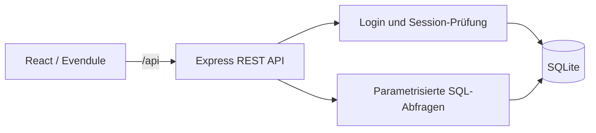
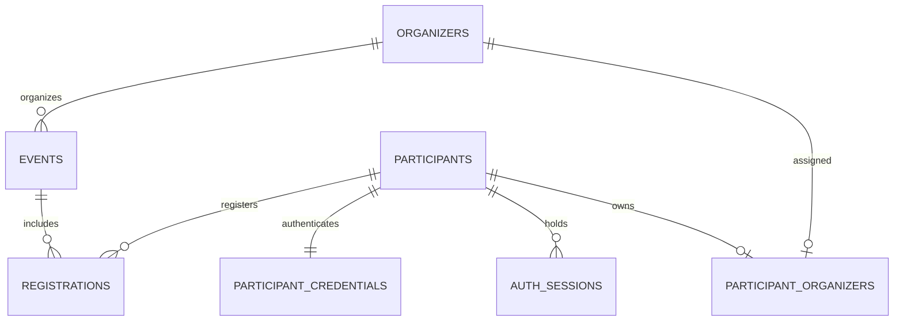

# Events API | Express + SQLite

[](https://github.com/jan-ninh/events-api-jan/actions/workflows/ci.yml)

**Eigenständiges Backend für eine Fullstack-Events-App.** Die Node.js-/Express-API verwaltet Benutzerkonten, Veranstaltungen und Teilnehmeranmeldungen in einer relationalen SQLite-Datenbank. Das [React-Frontend (Evendule)](https://github.com/jan-ninh/events-frontend) ist vollständig mit dieser API verbunden.

**[Live-Demo ausprobieren](https://evendule-live-jan.onrender.com)** · **[React-Frontend ansehen](https://github.com/jan-ninh/events-frontend)** · **[REST-Routen ansehen](src/app.js)** · **[SQL-Implementierung ansehen](src/db.js)** · **[Tests ansehen](test/)**


*Die React-Detailansicht zeigt die bestätigte Teilnehmeranmeldung. Event und Anmeldestatus stammen aus der Express-/SQLite-API.*

## Technischer Schwerpunkt

- **Relationales Datenmodell:** Veranstalter, Events, Teilnehmer, Anmeldungen, Zugangsdaten und Sessions.
- **Datenintegrität:** Fremdschlüssel und zusammengesetzter Primärschlüssel schützen Beziehungen und verhindern doppelte Event-Anmeldungen.
- **SQL statt ORM-Abstraktion:** Parametrisierte Abfragen mit `JOIN`, `GROUP BY`, `COUNT` und `SUM`.
- **REST-API:** Event-Erstellung, Listen- und Detailansichten, Anmeldung, Abruf des eigenen Anmeldestatus und serverseitig autorisiertes Event-Löschen mit kaskadierendem Entfernen der Anmeldungen.
- **Eventbilder:** Persistierte Bildkategorie, damit das React-Frontend je Event ein passendes Cover anzeigen kann.
- **Authentifizierung:** Passwort-Hashes mit `scrypt`, zufällige Bearer-Tokens mit Ablaufzeit und serverseitige Identitätsprüfung.
- **Zugriffskontrolle im Kernablauf:** Die API ermittelt Teilnehmer- und Veranstalterzuordnung aus der Session, statt Client-IDs ungeprüft zu übernehmen.
- **Qualitätssicherung:** Datenbanktests, HTTP-Integrationstests und ein erfolgreicher vollständiger Browserdurchlauf mit dem React-Frontend.

## Stack

`Node.js` · `JavaScript (ES Modules)` · `Express 5` · `SQLite` · `SQL` · `node:sqlite` · `REST` · `node:test`

## Architektur und Datenmodell





Die Kombination aus `event_id` und `participant_id` ist in der Registrierungstabelle eindeutig. Selbst wenn ein Client dieselbe Anmeldung wiederholt, lässt der Datenbank-Constraint keinen zweiten identischen Datensatz zu. Die API übersetzt diesen Konflikt in eine verständliche HTTP-Antwort.

## Lokal starten

Voraussetzungen: Node.js **ab 22.13**, npm, Git. Ohne externen Datenbankdienst lauffähig.

```bash
git clone https://github.com/jan-ninh/events-api-jan.git
cd events-api-jan
npm ci
npm test
npm start
```

Der Server startet auf `http://127.0.0.1:3001`. Die SQLite-Datei liegt in `data/events.sqlite` und wird nicht ins Repository eingecheckt. Auf Node 22 kann `node:sqlite` eine Experimental-Warnung ausgeben.

**API prüfen:**

```bash
curl http://127.0.0.1:3001/health
```

Erwartet: `{"status":"ok"}`.

Um die vollständige Anwendung zu testen, das [Frontend](https://github.com/jan-ninh/events-frontend) in einem zweiten Terminal starten. Der Vite-Proxy verbindet dessen `/api`-Aufrufe mit dieser API.

## API-Auswahl

| Methode | Route | Funktion |
| --- | --- | --- |
| `POST` | `/api/auth/signup` | Konto erstellen |
| `POST` | `/api/auth/login` | Anmelden und Session-Token erhalten |
| `GET` | `/api/auth/profile` | Eigenes Profil abrufen |
| `GET` | `/api/events` | Events auflisten |
| `GET` | `/api/events/:id` | Eventdetails abrufen |
| `POST` | `/api/events` | Als authentifizierter Benutzer Event erstellen |
| `POST` | `/api/events/:id/registrations` | Für ein Event anmelden |
| `GET` | `/api/events/:id/registrations` | Eigenen Anmeldestatus abrufen |
| `GET` | `/api/events/stats` | Veranstaltungen nach Organisator auswerten |

Beispiel für eine Event-Erstellung mit einem Token aus Login/Signup:

```http
POST /api/events
Authorization: Bearer <accessToken>
Content-Type: application/json

{
  "title": "Fullstack Meetup",
  "location": "Bochum",
  "description": "A meetup for developers",
  "startsAt": "2026-12-01T18:00:00Z"
}
```

Die `organizerId` wird dabei serverseitig aus der Session ermittelt. Die Teilnehmeranmeldung verwendet entsprechend die authentifizierte `participantId`. Doppelte Registrierungen liefern `409 Conflict`, fehlende Authentifizierung `401 Unauthorized`.

## Tests und Nachvollziehbarkeit

`npm test` führt Datenbank- und HTTP-Tests aus. Sie prüfen unter anderem Fremdschlüssel, SQL-Parameterbindung, Duplikatschutz, Login, ungültige und abgelaufene Sessions sowie die Bindung einer Anmeldung an die eingeloggte Identität. Der automatisierte Prüflauf ist über [GitHub Actions](https://github.com/jan-ninh/events-api-jan/actions) nachvollziehbar.

Die Integration mit React wurde lokal durchgespielt: Registrierung, Login, Event-Erstellung, Detailansicht, Anmeldung, Reload und erneuter Login.

## Einordnung

Das Backend entstand als **separat entwickelte Erweiterung** zu einer früheren WBS-Team-Events-App. Es verwendet eine eigenständige Implementierung mit direktem SQL-Zugriff. Die ursprünglichen Teambeiträge sind im [Frontend-Repository](https://github.com/jan-ninh/events-frontend) dokumentiert. Details zur Herkunft stehen unter [Project Origin](docs/PROJECT_ORIGIN.md).

**Status:** Öffentliche, ausdrücklich nicht-produktive [Fullstack-Live-Demo auf Render](https://evendule-live-jan.onrender.com). Die kostenlose API verwendet SQLite im Arbeitsspeicher und legt nach jedem Serverstart automatisch drei geschützte Beispielveranstaltungen an. Neue Accounts, Events und Anmeldungen bleiben nur bis zum nächsten Neustart erhalten. Authentifizierungsanfragen sind für diese Demo begrenzt, der Zugriff auf Löschfunktionen wird serverseitig autorisiert. Die lokale Entwicklungsfassung verwendet weiterhin die Datei `data/events.sqlite`. Für eine produktive Anwendung wären zusätzliche Schutzmaßnahmen und persistente Datenhaltung nötig.
